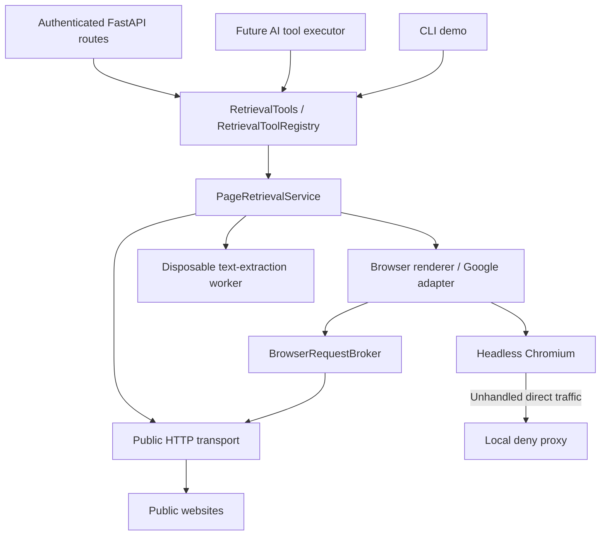

# Retrieval architecture and ownership

## Scope and decisions

The retrieval team owns independently testable search and page-reading functions.
The AI team owns tool selection, reasoning, confirmation policy, and cited answers.
The desktop team owns the Tauri gateway, token handoff, and native process supervision.

Python async Playwright controls Chromium headlessly. Google is the initial search
adapter, with live access disabled by default. The adapter is replaceable; retrieval
services have no dependency on LangGraph, an LLM, or an agent reasoning loop.
No third-party search API is used.

The original proposal called for a filtering proxy. The implemented design mediates
browser requests through Playwright routing and the validated Python HTTP transport.
This allows destination validation and decompressed size enforcement before fulfilling
responses, without opaque CONNECT tunnels or TLS interception. A separate local proxy
rejects all direct browser traffic as a fallback. It never connects upstream.

## Main components

| Component | Responsibility |
| --- | --- |
| `search/models.py` | Canonical Pydantic schemas and shared error codes |
| `search/api.py` | Authentication, HTTP mappings, body limits, and request IDs |
| `search/tools.py` | Framework-independent tool validation and safe error responses |
| `agent/tools/` | Existing registry and web adapter connected to retrieval services |
| `search/service.py` | Concurrency, operation deadlines, extraction, rendering fallback |
| `search/network.py` | Public URL/address policy and connection-time DNS validation |
| `search/http.py` | TLS, redirects, bounded HTTP downloads, resource responses |
| `search/browser.py`, `deny_proxy.py` | Browser/context lifecycle and direct-network denial |
| `search/browser_transport.py` | Resource mediation, budgets, and rendered DOM capture |
| `search/google.py` | Browser search interface and Google result parser |
| `search/extract.py` | Readable text and metadata extraction in a disposable worker |
| `search/config.py`, `demo.py` | Live/fixture service assembly and labeled synthetic mode |
| `launcher.py`, `runtime.py` | Source/frozen startup, bundled resources, extraction-worker mode |

## Network boundary

Only public HTTP/HTTPS destinations on ports 80 and 443 are permitted. Local files,
credentials in URLs, loopback, private, link-local, reserved, multicast, and selected
IPv6 transition/translation addresses are rejected. Mixed public/private DNS answers
are rejected as a whole.

The custom resolver gives validated numeric addresses directly to aiohttp's connector,
avoiding a second hostname lookup before connection. DNS caching and connection reuse
are disabled. Redirect destinations are validated separately. Host/SNI retain the
original hostname and certificate verification stays enabled. The CA store includes
system roots and certifi. Environment proxies, netrc auth, and cookie persistence are
disabled.

Browser HTTP requests use this same transport. Chromium's loopback proxy bypass and
direct hostname resolution are disabled. Service workers and WebSockets are blocked;
media, fonts, and subframes are omitted. Only GET/HEAD and supported textual resource
formats are forwarded. Cookies/authentication headers are not forwarded. Websites
requiring POST-based APIs or session state may fail.

This is an application-level retrieval boundary. It is not an OS firewall or a sandbox
against a compromised browser binary. Scripts execute in Chromium without NEXUS
application bindings. HTML extraction does not execute scripts. Google consent/access
challenges and declared paywalls produce explicit failures; there is no CAPTCHA bypass,
stealth implementation, or login automation. Paywall/challenge detection is not exhaustive.

## Initial operational budgets

| Setting | Value |
| --- | ---: |
| Search results | Default 5, maximum 10 |
| Query length | 500 characters |
| API request body | 16 KiB |
| Concurrent service operations / browser contexts | 2 per service/runtime instance |
| Queue wait | 10 seconds |
| Chromium startup | 30 seconds, within operation deadline |
| Navigation | 20 seconds |
| Search / browser operation | 45 seconds after admission |
| Page retrieval including fallback and extraction | 60 seconds after admission |
| HTTP connection / read timeout | 5 / 20 seconds |
| HTTP redirects | 5 |
| Browser main-frame navigations | 6 including the initial page |
| Browser requests | 50 per operation |
| HTTP/resource body | 5 MiB each on wire and after decompression |
| Aggregate browser decoded responses | 15 MiB |
| Rendered DOM returned to extractor | 5 MiB |
| Extractor worker deadline | 10 seconds within the page deadline |
| Returned article text | 30,000 characters, with `truncated` flag |
| Browser cleanup timeout | 5 seconds, separate from execution deadline |

The renderer waits up to five seconds for network idle. That is a bounded readiness
heuristic, not a guarantee that every delayed widget has finished. DOM size is checked
after capture; these limits are not hard browser-process memory limits.

## Lifecycle and packaging

FastAPI lifespan owns one lazy browser runtime and one service instance. Each browser
operation receives a fresh nonpersistent context. Success, failure, timeout, and
cancellation close the context. A crashed browser can restart on the next operation.
Backend shutdown closes the browser driver and deny proxy.

Text extraction runs in a disposable process so cancellation/deadlines can terminate
it. Source execution uses `python -m search.extract`; packaged execution re-enters the
engine executable in `--extract-worker` mode. PyInstaller onedir packages include
Python dependencies, the Playwright driver, an intact matching Chromium directory,
and fixture data. Missing resources fail explicitly; no runtime browser download occurs.

The macOS ARM64 package has been exercised locally. Windows has a native CI build and
fresh-runner smoke workflow prepared, but it has not run in this session. No Tauri MSI,
Windows desktop acceptance test, or production child-process supervisor is claimed.

After merging AI-Core, one FastAPI lifespan shuts down both the retrieval browser
and any initialized agent runtime. The canonical `ToolRegistry` stays owned by
AI-Core; `RetrievalToolRegistry` is a separate facade pending gateway integration.
Packaged startup includes the AI-Core SQL schema and defaults writable engine state
to `~/.nexus/`, with existing `NEXUS_*` state-path environment overrides respected.
